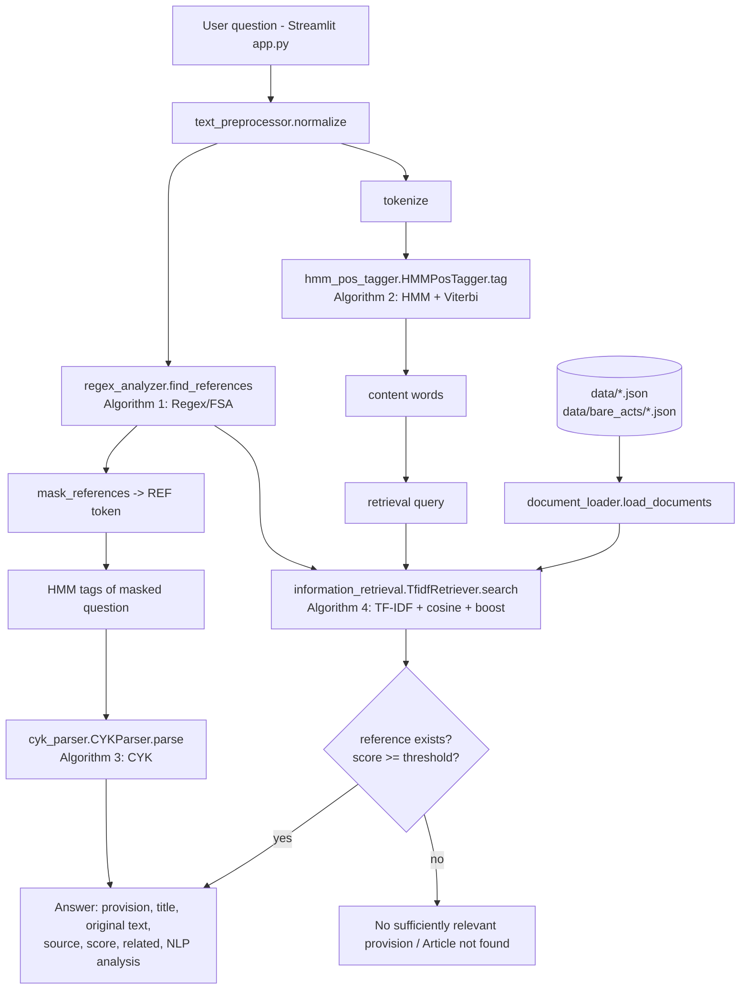
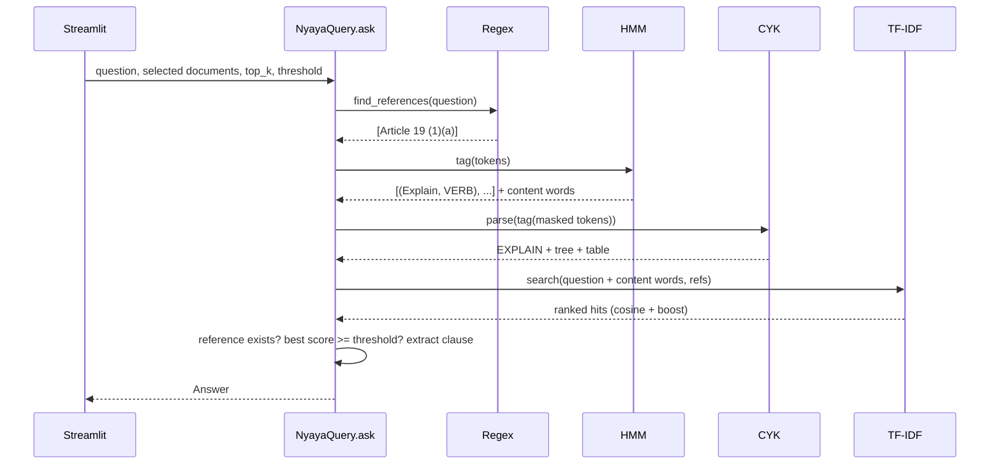

# NyayaQuery – Architecture

## System architecture

## Data flow

1. **Load** – `document_loader` reads every JSON file once at start-up and adds `id` and `label`.
2. **Index** – `TfidfRetriever` fits the TF-IDF matrix over all provisions; `HMMPosTagger` trains;
   both are cached by Streamlit (`st.cache_resource`), so this happens once per server.
3. **Query** – `NyayaQuery.ask()` runs the pipeline and returns an `Answer` dataclass.
4. **Display** – `app.py` renders the answer, related provisions and the NLP analysis panel.

## Modules

| Module | Responsibility |
|--------|----------------|
| `pdf_to_dataset.py` | One-time conversion of the Constitution PDF into JSON (existing, unchanged) |
| `document_loader.py` | Load and validate JSON datasets; Bare Acts are auto-discovered |
| `text_preprocessor.py` | Normalisation, tokenisation, stop words, Porter stemming |
| `regex_analyzer.py` | Reference detection, masking, clause extraction |
| `hmm_pos_tagger.py` | HMM training, Viterbi tagging, unknown-word signatures, content words |
| `cyk_parser.py` | CNF grammar, CYK table, parse tree, question type |
| `information_retrieval.py` | TF-IDF vectoriser, cosine similarity, boosting, document filter |
| `question_answering.py` | Orchestrates everything; confidence check; no-answer handling |
| `app.py` | Streamlit UI |

## Question answering workflow

## Extending

- **New Bare Act** – add `data/bare_acts/<name>.json` with the same schema.
- **New question shape** – add CNF rules to `GRAMMAR` and words to `LEXICON` in `cyk_parser.py`.
- **Better tagging** – add hand-tagged sentences to `DOMAIN_CORPUS` in `hmm_pos_tagger.py`.
